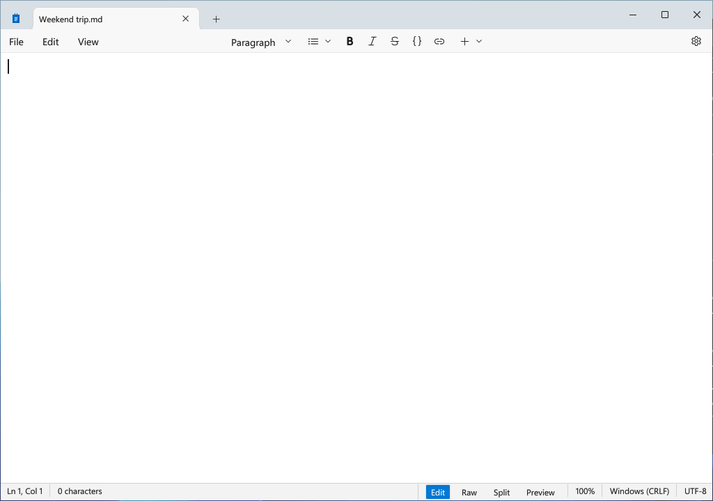
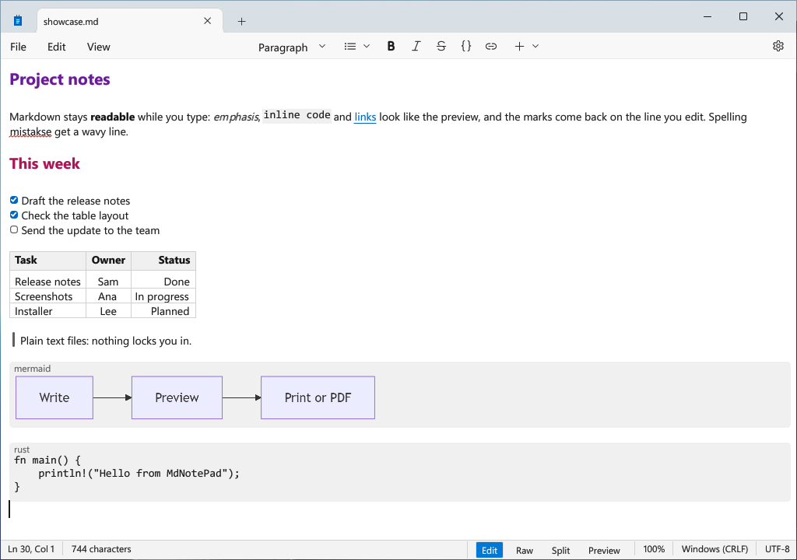
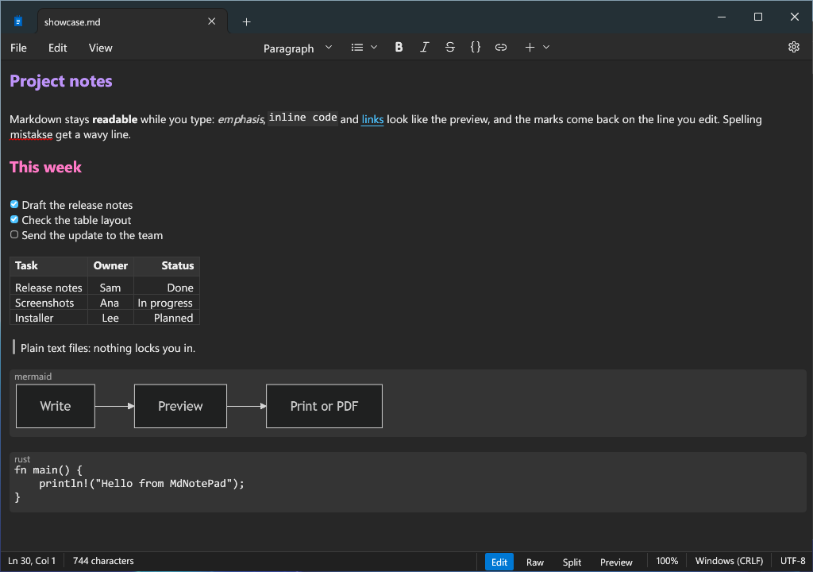
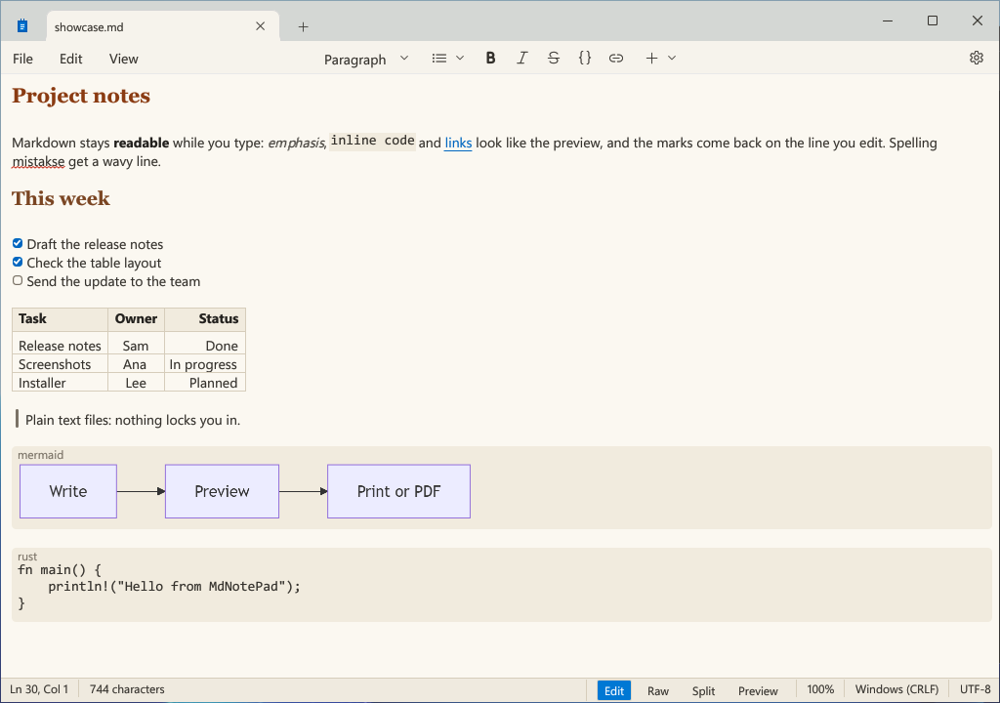
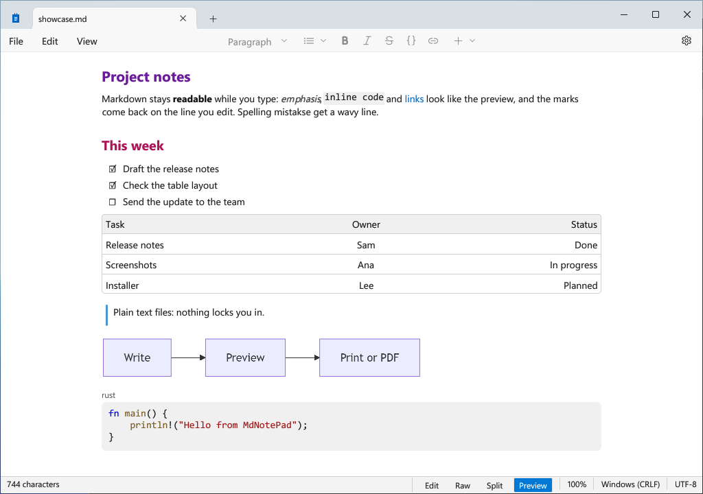
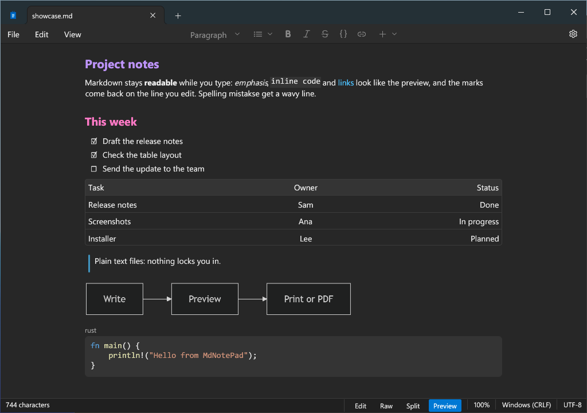
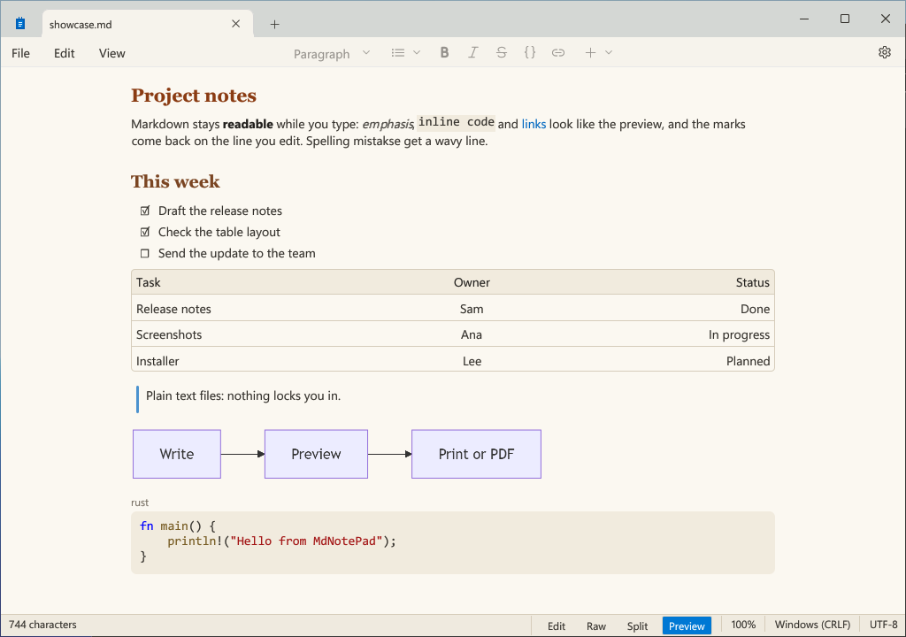
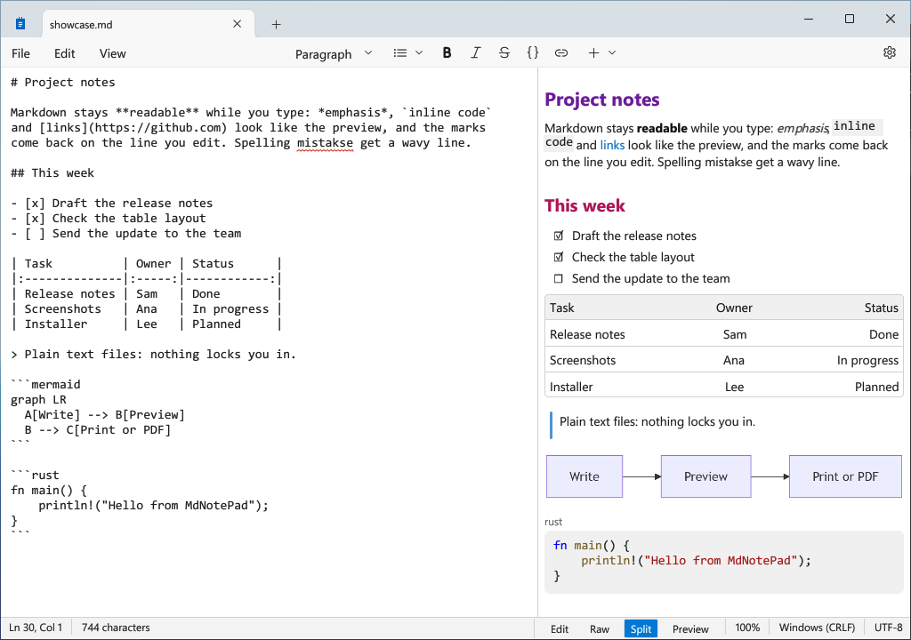

<div align="center">


# MdNotePad

**A Notepad-style Markdown editor for Windows.**

Plain `.md` files, a Windows 11 Notepad look, and formatting you can see while you type.
Native and fast: no web view, no Electron, no account, no network.

[Download](../../releases/latest) · [Features](#features) · [Keyboard shortcuts](#keyboard-shortcuts) · [Build](#build-from-source)

<br>



</div>

## Features

**Write**

- **Formatted editing.** Headings, bold, links, lists, quotes and code look like the preview while you type; the Markdown marks show only on the line you are editing.
- **Tables as a grid.** Columns line up; right-click to insert or delete rows and columns, Tab moves between cells.
- **Mermaid diagrams.** Flowcharts and other diagrams are drawn in the editor and the preview.
- **Spell check** with Windows' own checker: wavy underlines, suggestions on right-click, Add to dictionary.
- **Lists continue themselves**, task boxes tick with a click, and a pasted image is saved as a file and linked.
- **Formatting toolbar and shortcuts** for bold, italic, links, lists, tables, code and more.
- **Find and replace**, Go to line, and Format document (honours `.editorconfig`).

**Read and share**

- **Four modes:** Edit (formatted), Raw (plain text, like Notepad), Split (raw text next to the preview) and Preview. Ctrl+Enter switches.
- **Outline panel** of the headings, a **folder panel**, and **Quick open** (Ctrl+P).
- **Print** and **Save as PDF**, diagrams included.
- **Copy as formatted text** to paste into email or Word with the formatting kept.

**Fits into Windows**

- **Tabs**, restored on the next start, and one window that files open into.
- **Light, Dark, Paper and Neon themes**, or follow Windows.
- **File Explorer preview pane:** see `.md` files formatted without opening them (installer only).
- **Open `.md` files with MdNotePad** from Explorer, and Recent files in the File menu.
- **Changed elsewhere?** A file changed by another program reloads; with unsaved edits, MdNotePad asks first.
- **Line endings kept** (CRLF or LF, as the file has them), word wrap, zoom, focus mode and a status bar.

## Screenshots

| Light | Dark | Paper |
|:-:|:-:|:-:|
|  |  |  |
|  |  |  |

<p align="center">
  
</p>

## Download

Get the latest version from the [Releases page](../../releases/latest). Windows 10 or 11, 64-bit.

| | Installer | Portable |
|-|-|-|
| File | `MdNotePad-<version>-setup.exe` | `MdNotePad-<version>-portable.zip` |
| Install | Per user, no administrator rights | Unzip anywhere and run `MdNotePad.exe` |
| Start menu, uninstall | Yes | No |
| Open `.md` files with MdNotePad | A tick in the installer | Settings → *Make MdNotePad the default…* |
| Explorer preview pane | A tick in the installer | No |
| Settings kept in | Your user profile | A `data` folder next to the exe |

Or install the portable version with [Scoop](https://scoop.sh/):

```sh
scoop bucket add mdnotepad https://github.com/candiesdoodle/mdnotepad
scoop install mdnotepad
```

The downloads are not code-signed yet, so Windows SmartScreen may warn the first time: choose
**More info → Run anyway**. Each release lists SHA-256 checksums.

Saving as PDF and drawing diagrams use Microsoft Edge (part of Windows) in the background, offline.

## Keyboard shortcuts

| Shortcut | Action | Shortcut | Action |
|-|-|-|-|
| Ctrl+N, Ctrl+T | New tab | Ctrl+F | Find |
| Ctrl+O | Open | Ctrl+H | Replace |
| Ctrl+P | Quick open | F3, Shift+F3 | Find next, previous |
| Ctrl+S | Save | Ctrl+G | Go to line |
| Ctrl+Shift+S | Save as | F5 | Insert time and date |
| Ctrl+Alt+S | Save all | Ctrl+Alt+F | Format document |
| Ctrl+W | Close tab | Ctrl+Enter | Next mode |
| Ctrl+Tab, Ctrl+Shift+Tab | Next, previous tab | Ctrl+Shift+T | Outline panel |
| Ctrl+B, Ctrl+I, Ctrl+D | Bold, italic, strikethrough | F11 | Focus mode |
| Ctrl+E, Ctrl+K | Inline code, link | Ctrl+Plus, Ctrl+Minus, Ctrl+0 | Zoom |
| Ctrl+Shift+U, O, L | Bullet, numbered, task list | Ctrl+Shift+C | Copy as formatted text |
| Ctrl+Shift+Q, K, G | Quote, code block, table | Tab, Shift+Tab (in a table) | Next, previous cell |

## Command line

```text
MdNotePad [file]                 open a file (in Preview; -e, -r, -s or -p to choose the mode)
MdNotePad --new-window [file]    open in a new window instead of the running one
MdNotePad --register-file-types  open .md, .markdown and .txt files with MdNotePad
MdNotePad --register-preview     show .md files in Explorer's preview pane (needs the DLL)
MdNotePad --unregister-file-types
MdNotePad --version
```

## Build from source

On Windows, with [Rust](https://rustup.rs) (the version in `rust-toolchain.toml` is installed
automatically):

```text
cargo build --release -p rustdown-app
```

This makes `target\release\MdNotePad.exe` and `mdnotepad_preview.dll`.
`installer\package.ps1 -SourceDir target\release` builds the installer and the portable zip
(it needs [Inno Setup 6](https://jrsoftware.org/isinfo.php)).

## Credits and license

MdNotePad started as a fork of [rustdown](https://github.com/teh-hippo/rustdown) by teh-hippo and is
built with [egui](https://github.com/emilk/egui) and [pulldown-cmark](https://github.com/pulldown-cmark/pulldown-cmark).

[MIT License](LICENSE): © 2026 candiesdoodle; rustdown © 2026 teh-hippo.
The bundled fonts and Mermaid have their own licenses: see [THIRD-PARTY-NOTICES.md](THIRD-PARTY-NOTICES.md).
