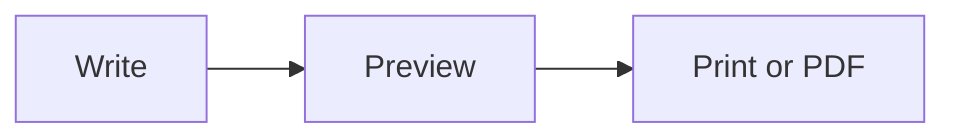

# Project notes

Markdown stays **readable** while you type: *emphasis*, `inline code` and [links](https://github.com) look like the preview, and the marks come back on the line you edit. Spelling mistakse get a wavy line.

## This week

- [x] Draft the release notes
- [x] Check the table layout
- [ ] Send the update to the team

| Task          | Owner | Status      |
|:--------------|:-----:|------------:|
| Release notes | Sam   | Done        |
| Screenshots   | Ana   | In progress |
| Installer     | Lee   | Planned     |

> Plain text files: nothing locks you in.



```rust
fn main() {
    println!("Hello from MdNotePad");
}
```
